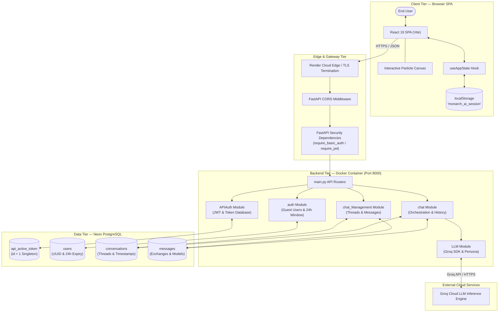
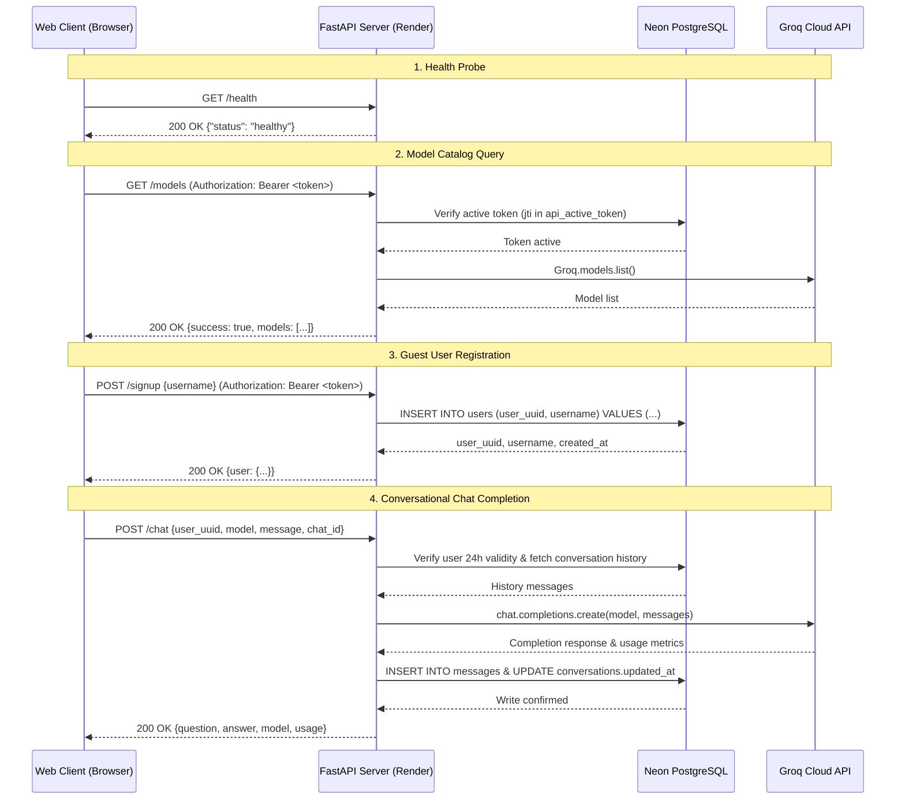
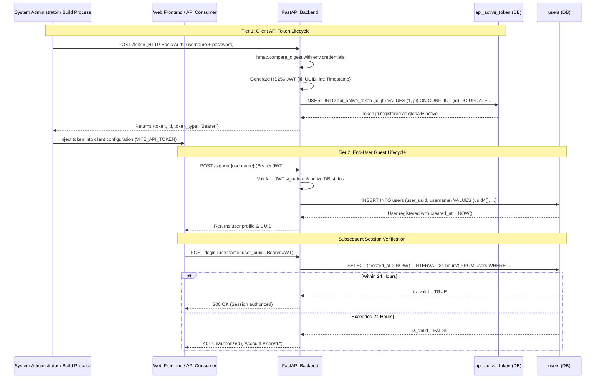
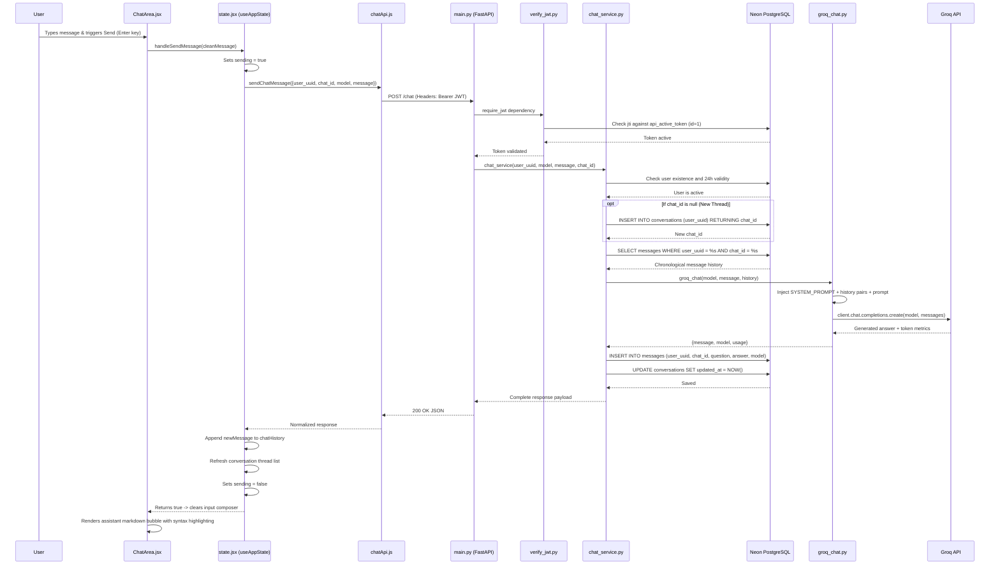
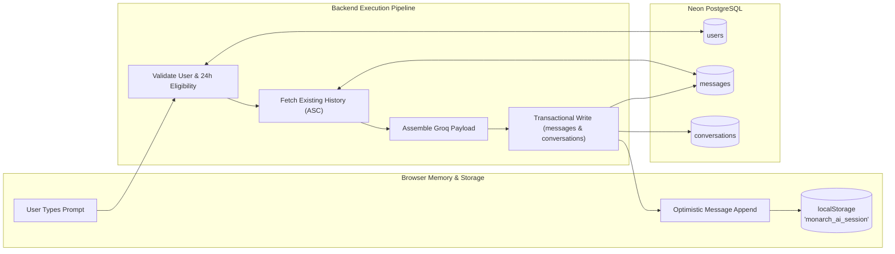
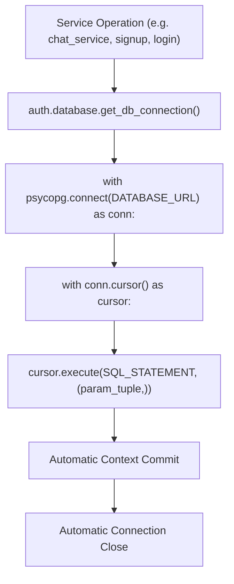
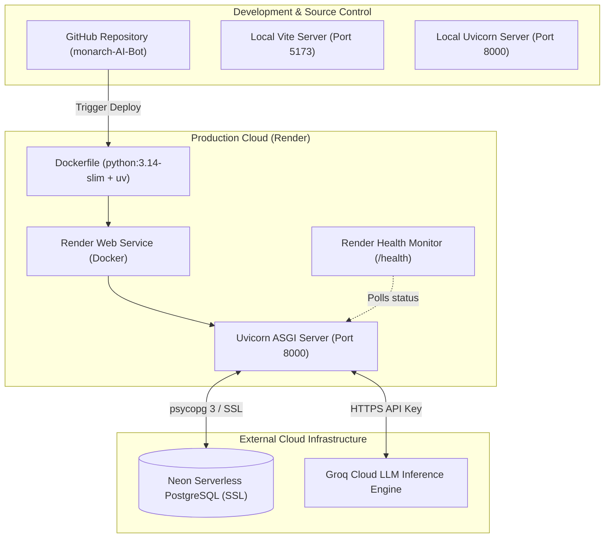

# Monarch AI Bot — System Architecture Documentation

## 1. Document Metadata and Version

| Parameter | Specification |
|---|---|
| **Document Title** | Monarch AI Bot - System Architecture Documentation |
| **Project** | Monarch AI Bot |
| **Project Version** | `v1.0.0` |
| **Documentation Version** | `v1.0.0` |
| **Document Type** | Comprehensive System Architecture & Lifecycle Specification |
| **Last Updated** | 2026-11-11 |
| **Verification Status** | Verified against source code repository |

---

## 2. Product Overview

**Monarch AI Bot** is a full-stack, production-grade conversational AI platform that provides low-latency interactions with leading Large Language Models hosted on **Groq**. The system combines a modern, responsive **React 19 & Vite** web client with a containerized **FastAPI & Python 3.14** backend deployed on **Render** and backed by serverless **Neon PostgreSQL**.

The platform is engineered around three foundational architectural principles:
1. **Privacy-Preserving Ephemeral Identity**: Users access the platform through lightweight guest accounts governed by a 24-hour expiration window. No passwords or personal data are collected.
2. **Deterministic Dual-Tier Security**: API communications are secured through HTTP Basic Auth-issued signed HS256 JSON Web Tokens enforced through a database-tracked single active token model, while conversational data is strictly scoped to valid user UUIDs.
3. **High-Performance Stateless Inference**: Multi-turn dialogue context is dynamically reconstructed from relational history tables and forwarded to Groq's high-speed inference engine with custom system persona constraints.

---

## 3. System Architecture



---

## 4. Technology Stack

### Summary Table

| Subsystem | Technology | Purpose |
|---|---|---|
| **Frontend Framework** | React 19 (`^19.3.1`) | UI component hierarchy and concurrent rendering |
| **Frontend Tooling** | Vite 8 (`^8.3.6`) | Fast development server and production Rollup bundler |
| **UI Components** | Ant Design (`antd ^6.7.0`) | Layout, menus, inputs, selects, buttons, and alert banners |
| **Markdown Rendering** | `react-markdown` (`^10.1.0`) | Safe Abstract Syntax Tree Markdown DOM parser |
| **Syntax Highlighting** | `rehype-highlight` + `highlight.js` | Code block highlighting styled with GitHub Dark |
| **Backend Runtime** | Python 3.14 (`python:3.14-slim`) | Core language execution environment |
| **REST API Framework** | FastAPI (`>=0.162.0`) | High-concurrency async web framework and OpenAPI docs |
| **ASGI Web Server** | Uvicorn (`>=0.54.0`) | High-speed server hosting FastAPI |
| **Database Adapter** | `psycopg` 3 (`>=3.3.8`) | Parameterized SQL execution adapter for PostgreSQL |
| **Relational Database** | Neon PostgreSQL | Serverless cloud relational database |
| **Cryptographic Tokens** | PyJWT (`>=2.15.1`) | HS256 token issuance and claim verification |
| **Data Validation** | Pydantic | Request schema parsing and payload type validation |
| **Python Package Manager**| Astral `uv` | Dependency resolution and container virtual environment management |
| **Inference Provider** | Groq Cloud API (`groq >=1.7.0`) | High-speed LLM chat completions and model catalog queries |
| **Cloud Hosting** | Render | Docker Web Service container hosting |

---

## 5. Major System Components

The Monarch AI Bot architecture divides responsibility into discrete, loosely-coupled modules:

```text
┌────────────────────────────────────────────────────────────────────────┐
│                              CLIENT TIER                                │
├───────────────────────┬────────────────────────┬───────────────────────┤
│    Auth Screen        │      Chat Area         │     Control Panel     │
│  (Interactive Canvas  │  (Markdown & Syntax    │  (Profile & Expiry    │
│   & Guest Forms)      │   & Model Selector)    │   & Logout Action)    │
├───────────────────────┴────────────────────────┴───────────────────────┤
│           Central State Hook: useAppState (src/state.jsx)              │
│       Network Service Clients: auth.js and chatApi.js (AbortSignals)    │
└───────────────────────────────────┬────────────────────────────────────┘
                                    │ HTTPS + Bearer JWT
┌───────────────────────────────────▼────────────────────────────────────┐
│                              SERVER TIER                                │
├────────────────────────────────────────────────────────────────────────┤
│                 FastAPI Application Entry (main.py)                    │
│        Dependencies: require_basic_auth & require_jwt (Active DB Check)│
├───────────────────────┬────────────────────────┬───────────────────────┤
│   APIAuth/            │   auth/                │   chat/               │
│   (Basic Auth & JWT   │   (Guest Registration  │   (Orchestration,     │
│    Active Singleton)  │    & 24h Expiration)   │    Creation, History) │
├───────────────────────┼────────────────────────┼───────────────────────┤
│   chat_Management/    │   LLM/                 │   Database Engine     │
│   (History & Thread   │   (Groq Completions    │   (psycopg 3 Direct   │
│    Listings)          │    & Persona Prompt)   │    Parameterized SQL) │
└───────────────────────┴───────────┬────────────┴───────────────────────┘
                                    │
              ┌─────────────────────┴─────────────────────┐
              ▼                                           ▼
┌───────────────────────────┐               ┌───────────────────────────┐
│     DATA PERSISTENCE      │               │     LLM INFERENCE         │
│     Neon PostgreSQL       │               │     Groq Cloud API        │
│  (Users, Conversations,   │               │  (Dynamic Catalog & Chat  │
│   Messages, Active Token) │               │   Completions)            │
└───────────────────────────┘               └───────────────────────────┘
```

---

## 6. Component Responsibilities

| Component | File Path | Core Architectural Responsibility |
|---|---|---|
| **View Switcher** | `client/src/App.jsx` | Renders unauthenticated canvas view or 3-column workspace based on `user` state |
| **State Hub** | `client/src/state.jsx` | Encapsulates user session, active thread, model catalog, and network states |
| **Auth View** | `client/src/Auth/AuthenticationScreen.jsx` | Manages split layout and 2D canvas particle animation respecting accessibility settings |
| **Chat View** | `client/src/ChatArea/ChatArea.jsx` | Displays conversation stream, welcome suggestions, code syntax, and message composer |
| **Profile Drawer** | `client/src/ControlPanel/ControlPanel.jsx` | Renders user UUID, account creation time, calculated 24h expiration in IST, and logout |
| **Nav Drawer** | `client/src/Sidebar/Sidebar.jsx` | Lists conversations ordered by latest activity with "+ New Chat" action |
| **Auth Client** | `client/src/ControlPanel/Account/auth.js` | Dispatches `/signup`, `/login`, `/chats`, `/chat/history` with deduplication |
| **Chat Client** | `client/src/ChatArea/chatApi.js` | Dispatches `/chat` completions and `/models` catalog queries with AbortController |
| **API Entry** | `server/main.py` | Exposes REST endpoints, validates schemas, configures CORS, handles dependencies |
| **Client Auth** | `server/APIAuth/` | Verifies Basic Auth, signs HS256 JWTs, and enforces single active token in DB (`id = 1`) |
| **User Identity**| `server/auth/` | Registers guest users, verifies 24-hour validity via SQL interval, manages DB connections |
| **Chat Core** | `server/chat/` | Coordinates user validation, thread creation, history gathering, LLM execution, saving |
| **Thread Queries**| `server/chat_Management/` | Validates UUID inputs and queries conversations and message logs |
| **LLM Driver** | `server/LLM/` | Formats Groq completions request with system prompt and history; lists active models |

---

## 7. Frontend-to-Backend Communication

Frontend components never communicate directly with external third-party services (such as Groq or Neon); all interactions traverse the FastAPI backend over secure HTTPS:



---

## 8. Authentication Lifecycle

The architecture implements a **two-tier security boundary**:



### The Single Active Token Rule
Because `api_active_token` enforces a fixed primary key of `id = 1`, issuing a new token via `POST /token` replaces the `jti` column. If an older token is presented by any client, the database verification check (`verify_active_token`) immediately rejects it, providing instant global token revocation without requiring token blacklists or cache invalidation.

---

## 9. User and Guest Account Lifecycle

```mermaid
flowchart TD
    Start([Visitor arrives at frontend]) --> UnauthCheck{Saved session in localStorage?}
    
    UnauthCheck -->|No| ShowAuth[Display AuthenticationScreen]
    UnauthCheck -->|Yes| Rehydrate[Rehydrate user & selectedChatId]
    
    ShowAuth --> ActionChoice{User action}
    ActionChoice -->|Create Account| SignupCall[POST /signup with chosen username]
    SignupCall --> GenUUID[Server generates UUID v4 & sets created_at = NOW()]
    GenUUID --> DisplayCopy[Show UUID with one-click copy button]
    DisplayCopy --> LoginCall
    
    ActionChoice -->|Sign In| LoginCall[POST /login with username & UUID]
    Rehydrate --> ValidateSession[Execute initial /chats API request]
    
    LoginCall --> Check24h{created_at > NOW() - 24 hours?}
    ValidateSession --> Check24h
    
    Check24h -->|No - Expired| ExpiredAlert[Return 401 Unauthorized]
    ExpiredAlert --> ClearStorage[Purge localStorage 'monarch_ai_session']
    ClearStorage --> ShowAuth
    
    Check24h -->|Yes - Active| EnterWorkspace[Mount Authenticated Workspace Layout]
    EnterWorkspace --> ActiveUse[User interacts with chat and conversations]
    
    ActiveUse --> UserLogout[User clicks Logout in ControlPanel]
    UserLogout --> ClearStorage
```

---

## 10. Chat Request Lifecycle



---

## 11. Conversation and Message Data Flow



---

## 12. LLM Request and Response Lifecycle

### Prompt Assembly and Persona Constraints
The backend ensures concise, token-efficient, and accurate conversational responses by sandwiching the conversation between a strict **System Persona** and the latest user prompt:

1. **Persona Injection (`server/LLM/prompt.py`)**:
   - Persona defines Monarch AI as a helpful, intelligent, and reliable assistant.
   - Mandates conciseness: 1–3 sentence responses for simple questions, minimal boilerplate, no unsolicited conclusions or filler.
   - Prohibits hallucination and requires admitting uncertainty when facts are missing.
2. **Context Alternation (`server/LLM/groq_chat.py`)**:
   - Prior exchanges from `messages` table are unpacked into standard role pairs:
     ```python
     {"role": "user", "content": question}
     {"role": "assistant", "content": answer}
     ```
3. **Execution**:
   - Sent via `client.chat.completions.create(model=model, messages=messages)`.
4. **Usage Extraction**:
   - Token statistics (`prompt_tokens`, `completion_tokens`, `total_tokens`) are parsed from `response.usage` and propagated to the client.

---

## 13. Database Interaction Flow

The database layer runs on **Neon PostgreSQL** using direct parameterized queries via `psycopg 3`:



- **Connection Lifetime**: Scoped per operation; connections are opened at the start of a request handler and cleanly closed upon completion.
- **Transactions**: Python context managers (`with conn:`) automatically issue `COMMIT` upon normal block completion or `ROLLBACK` if an unhandled exception occurs.

---

## 14. Error Handling Across System Boundaries

```mermaid
flowchart TD
    Req["Incoming Request"] --> BoundaryCheck{"Boundary Layer"}
    
    BoundaryCheck -->|Network / Transport| NetError["Connection Timeout / Drop"]
    NetError --> AbortAction["AbortController triggers TimeoutError (15s/30s)"]
    AbortAction --> UI_Alert["Ant Design Alert Banner (User Retries)"]
    
    BoundaryCheck -->|Authentication| AuthError{"Auth Rejection"}
    AuthError -->|Invalid / Missing JWT| RejectJWT["401 Unauthorized (Bearer)"]
    AuthError -->|Expired Guest (>24h)| Reject24h["401 Unauthorized (Login) / 400 Bad Request (Chat)"]
    RejectJWT --> ResetClient["useAppState.handleSessionExpired() cleans localStorage"]
    Reject24h --> ResetClient
    ResetClient --> UI_AuthScreen["Return to AuthenticationScreen"]
    
    BoundaryCheck -->|Input Validation| ValError["Pydantic / ValueError"]
    ValError --> RejectVal["422 Unprocessable / 400 Bad Request"]
    RejectVal --> PreserveInput["Error displayed; input preserved in composer"]
    
    BoundaryCheck -->|External LLM| GroqError{"Groq API Failure"}
    GroqError -->|RateLimitError / AuthError| GroqExcept["400 Bad Request with error detail"]
    GroqExcept --> PreserveInput
    
    BoundaryCheck -->|Database| DBError["psycopg.Error / OperationalError"]
    DBError --> Internal500["500 Internal Server Error"]
    Internal500 --> GenericAlert["User alerted with safe error message"]
```

---

## 15. Deployment Architecture



---

## 16. Security Architecture

### Key Security Safeguards
1. **Constant-Time Basic Authentication**: `APIAuth/basic_auth.py` compares administrative credentials using `hmac.compare_digest` to prevent timing attacks.
2. **Instant Global Token Revocation**: Active tokens are validated against `api_active_token (id = 1)`. Generating a new token revokes the previous token immediately across all active sessions.
3. **Strict SQL Parameterization**: All queries use positional tuples (`%s`), preventing SQL injection attacks across all database interactions.
4. **No Password Storage**: End users do not supply passwords; accounts are identified exclusively by username and server-generated UUID v4 tokens.
5. **Cascading Relational Deletion**: All child records in `conversations` and `messages` are bound to `users(user_uuid)` via `ON DELETE CASCADE`.
6. **XSS Mitigation in Frontend**: Assistant responses are rendered using `react-markdown` AST compilation rather than `dangerouslySetInnerHTML`.
7. **Secret Isolation**: All credentials, keys, and connection strings are managed through environment variables and excluded from version control.

---

## 17. Current Implementation Limitations

To maintain full transparency, the following architectural constraints reflect the verified state of the codebase:

1. **Synchronous LLM Completions (No Streaming)**: Responses are delivered in full after generation. Server-Sent Events (SSE) or WebSockets are not currently implemented.
2. **Singleton Active API Token**: The backend supports exactly one active JWT token globally via `api_active_token (id = 1)`. Issuing a token for one client revokes it for any other client using that backend instance.
3. **No Automatic Database Cleanup Cron**: While expired guest accounts (>24 hours) are immediately blocked by SQL checks (`created_at > NOW() - INTERVAL '24 hours'`), there is no automated background cron worker to physically delete expired rows from PostgreSQL.
4. **Static Title Assignment**: Conversation titles default to `null` in the database, with the frontend falling back to formatting the conversation's `updated_at` date. Automatic title summarization via LLM is not implemented.
5. **No Per-IP Rate Limiting**: Request rate limiting is not enforced at the application layer; rate limits currently depend on upstream Render edge proxies or Groq API tier limits.

