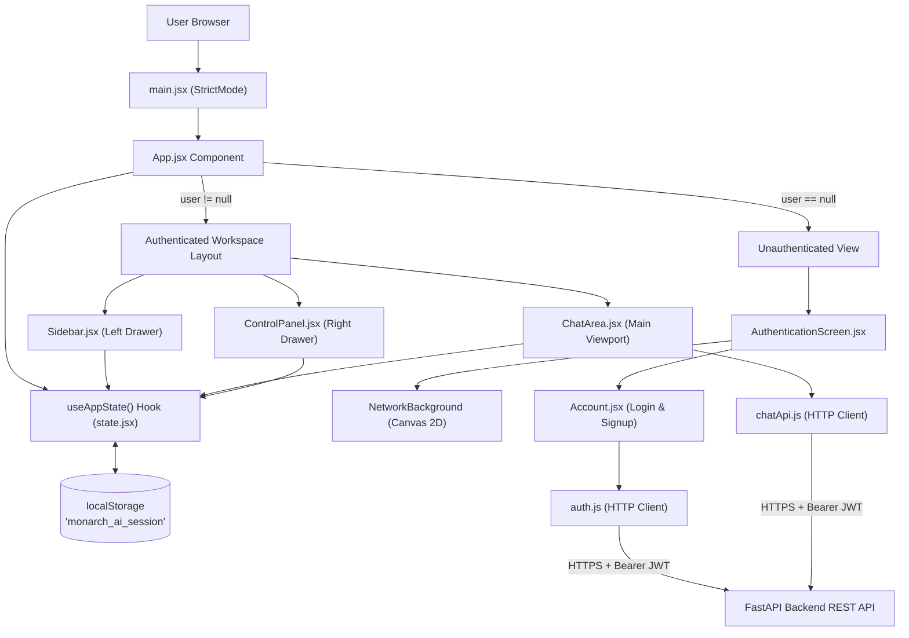
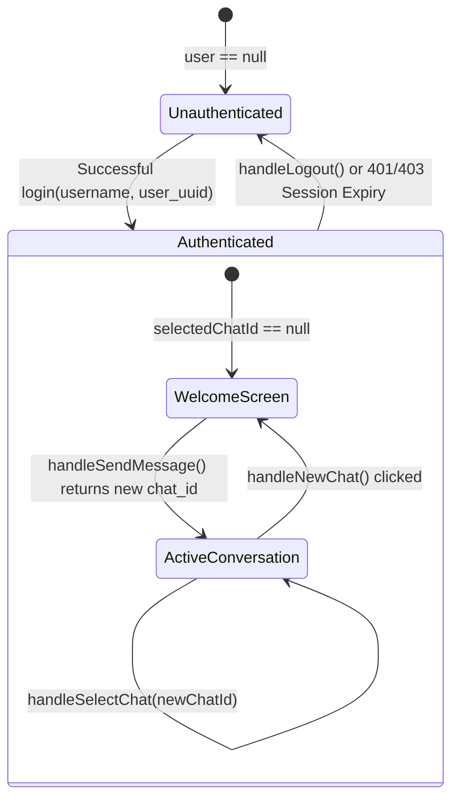
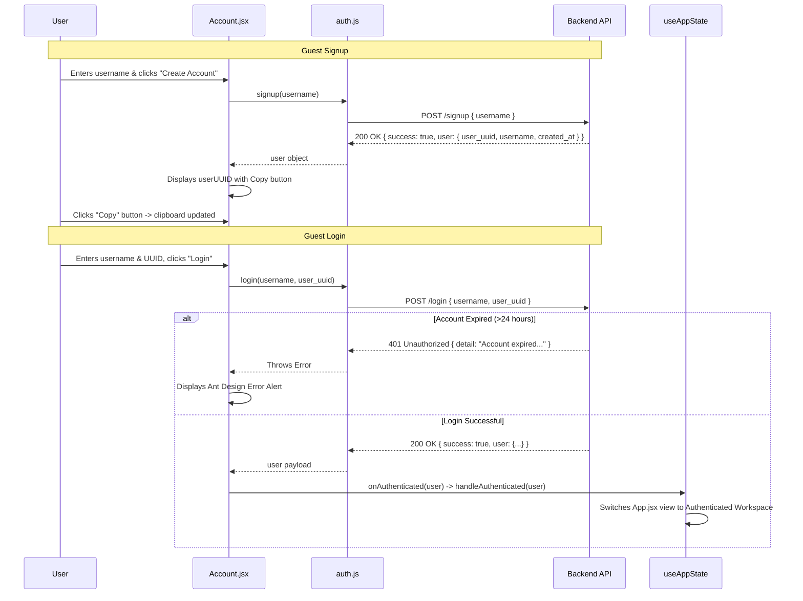
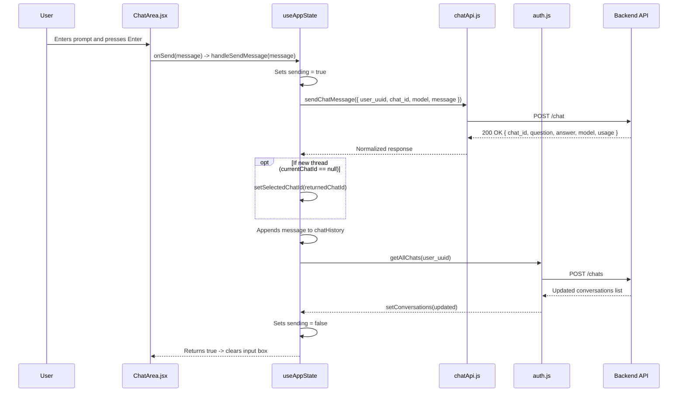

# Monarch AI Bot — Client Technical Documentation

## 1. Document Metadata and Version

| Parameter | Specification |
|---|---|
| **Document Title** | Monarch AI Bot - Client Technical Documentation |
| **Project** | Monarch AI Bot |
| **Project Version** | `v1.0.0` |
| **Documentation Version** | `v1.0.0` |
| **Document Type** | Client Frontend Architecture & Implementation Reference |
| **Last Updated** | 2026-11-11 |
| **Verification Status** | Verified against source code repository |

---

## 2. Client Overview

The **Monarch AI Bot** frontend is a high-performance, single-page application (SPA) built using **React 19**, **Vite 8**, and **Ant Design (antd 6)**. It serves as the primary conversational interface for users interacting with the Monarch AI platform.

The client is engineered with a strict two-stage user experience:
1. **Unauthenticated Experience**: A full-screen authentication interface featuring an interactive HTML5 canvas particle/network animation that responds dynamically to pointer movements while honoring user accessibility preferences (`prefers-reduced-motion`). It provides guest user signup and login workflows with one-click clipboard copying for generated UUIDs.
2. **Authenticated Workspace**: A comprehensive three-column workspace comprising:
   - **Collapsible Sidebar**: Displays conversation threads sorted chronologically by update timestamp, a "New Chat" thread initiator, branding, and guest user status.
   - **Central Chat Area**: Features a model selection dropdown fed by dynamic Groq model discovery, rich Markdown message rendering powered by `react-markdown` and `remark-gfm` with syntax-highlighted code blocks styled in GitHub Dark, suggestion quick-starts, and a multi-line auto-submitting composer.
   - **Collapsible Control Panel**: Displays the authenticated guest user's profile, full UUID, account creation time, calculated 24-hour expiration timestamp in Indian Standard Time (IST), and a clean session termination action (Logout).

Session state is persisted locally via browser `localStorage`, with automated session invalidation triggered upon receiving `401 Unauthorized` or `403 Forbidden` API responses.

---

## 3. Frontend Technology Stack

The client implementation relies on modern JavaScript libraries and utility packages pinned in `package.json`:

| Category | Technology | Version | Purpose |
|---|---|---|---|
| **Core Framework** | React | `^19.3.1` | Declarative user interface library with concurrent rendering and hooks |
| **DOM Renderer** | React DOM | `^19.3.1` | React renderer for the web browser DOM |
| **Build Tool & Server** | Vite | `^8.3.6` | Next-generation ESM development server and Rollup-based production bundler |
| **React Vite Plugin** | `@vitejs/plugin-react` | `^6.1.2` | Fast refresh and JSX compilation via Babel |
| **UI Component Library** | Ant Design (`antd`) | `^6.7.0` | Enterprise UI components (Layout, Menu, Button, Input, Select, Alert, Tooltip, Avatar) |
| **Component Icons** | `@ant-design/icons` | `^6.3.4` | Vector iconography integrated with Ant Design |
| **Markdown Parsing** | `react-markdown` | `^10.1.0` | React component to safely render Markdown AST into DOM elements |
| **GFM Extension** | `remark-gfm` | `^4.0.1` | Remark plugin enabling GitHub Flavored Markdown (tables, autolinks, strikethrough) |
| **Syntax Highlighting** | `rehype-highlight` | `^7.0.2` | Rehype plugin for code block tokenization and syntax highlighting |
| **Highlight Engine** | `highlight` / `highlight.js` | `^0.2.4` / styles | Syntax highlighting engine and theme styles (`github-dark.css`) |
| **Code Quality** | ESLint | `^10.14.0` | Static analysis and code quality enforcement with React hooks plugins |

---

## 4. Client Directory Structure

The frontend repository layout is structured into modular feature directories:

```text
client/
├── public/
│   ├── monarch-logo.png            # Static application icon
│   └── vite.svg                    # Default Vite asset
├── src/
│   ├── assets/
│   │   ├── monarch-logo.png        # Brand logo with dark background
│   │   ├── monarch-logo-transparent.png # Transparent brand logo for splash screens
│   │   └── purple-landscape.svg    # Background SVG illustration
│   ├── Auth/
│   │   ├── AuthenticationScreen.css# Styling for split-panel login and particle canvas
│   │   └── AuthenticationScreen.jsx# Full-screen wrapper & interactive Canvas 2D particle network
│   ├── ChatArea/
│   │   ├── chatApi.js              # Network services for chat message dispatch & model catalog discovery
│   │   ├── ChatArea.css            # Styles for message bubbles, composer, and Markdown code blocks
│   │   └── ChatArea.jsx            # Core chat viewport, welcome view, Markdown renderer, model selector
│   ├── ControlPanel/
│   │   ├── Account/
│   │   │   ├── Account.css         # Styling for login/signup forms, inputs, and alerts
│   │   │   ├── Account.jsx         # Guest authentication form component with UUID copy functionality
│   │   │   └── auth.js             # Network services for signup, login, chats list, and chat history
│   │   ├── ControlPanel.css        # Styles for right-hand collapsible settings panel
│   │   └── ControlPanel.jsx        # User profile inspector, 24-hour expiration calculator, and logout trigger
│   ├── Sidebar/
│   │   ├── Sidebar.css             # Styles for collapsible conversation navigation menu
│   │   └── Sidebar.jsx             # Left drawer with sorted conversation history and New Chat button
│   ├── App.css                     # Root layout grid and dark theme container styles
│   ├── App.jsx                     # Top-level view switcher (Auth screen vs. Workspace layout)
│   ├── index.css                   # Global styling resets, typography, and dark theme definitions
│   ├── main.jsx                    # React application entry point mounting root inside StrictMode
│   └── state.jsx                   # Central application state manager (useAppState custom hook)
├── .env                            # Client environment variables (API base URL, Bearer JWT)
├── .gitignore                      # Git exclusion rules for node_modules, dist, and local env files
├── eslint.config.js                # ESLint configuration supporting React 19 rules of hooks
├── index.html                      # HTML5 host document mounting #root
├── package.json                    # NPM dependencies, scripts, and build configuration
├── package-lock.json               # Locked dependency resolution tree
├── README.md                       # Vite React project documentation
└── vite.config.js                  # Vite configuration bundled with React plugin
```

---

## 5. Application Architecture

The client follows a centralized state architecture using a custom hook (`useAppState`) located in `src/state.jsx`. All persistent state, active thread tracking, message caches, network request dispatching, and error normalization are handled by this hook, leaving individual components focused purely on presentation and event handling.

### High-Level Architecture Diagram



---

## 6. Application Entry Point and Initialization

### Bootstrapping Lifecycle

1. **HTML Mounting (`index.html`)**: Loads the single HTML container defining `<div id="root"></div>` and scripts `src/main.jsx`.
2. **React Root Rendering (`src/main.jsx`)**:
   ```jsx
   createRoot(document.getElementById('root')).render(
     <StrictMode>
       <App />
     </StrictMode>
   );
   ```
   Uses React 19's `createRoot` and wraps the root application in `<StrictMode>` to assist in detecting unintended side-effects during development.
3. **Session Rehydration (`src/state.jsx`)**:
   Upon mounting, `useAppState()` invokes `getSavedSession()` synchronously to inspect `localStorage.getItem("monarch_ai_session")`.
   - If a serialized JSON object is present, it extracts `{ user, selectedChatId, selectedModel }`.
   - If no valid session is found, it initializes state with `user = null` and falls back to `DEFAULT_MODEL = "openai/gpt-oss-20b"`.
4. **Catalog Discovery & Conversation Synchronization**:
   - `useAppState()` immediately fires an asynchronous request to `getAvailableModels()` via `chatApi.js` to populate `availableModels`.
   - If a rehydrated `user` object exists, a secondary `useEffect` triggers `getAllChats(user.user_uuid)` to populate the conversation list.

---

## 7. Pages, Components, and Their Responsibilities

### 1. `App.jsx`
Acts as the root view switcher:
- Inspects `user` returned from `useAppState()`.
- If `user` is falsy, mounts `<AuthenticationScreen>` wrapping `<Account onAuthenticated={handleAuthenticated} />`.
- If `user` is present, renders the three-column authenticated layout: `<Sidebar>`, `<Content className="main-workspace"><ChatArea /></Content>`, and `<ControlPanel>`.

### 2. `AuthenticationScreen.jsx`
Provides the visual backdrop and branding for unauthenticated visitors:
- **`NetworkBackground` Subcomponent**: Creates an interactive HTML5 2D canvas containing between 35 and 110 animated nodes (proportional to screen area: `Math.floor(area / 14000)`).
  - Listens to pointer motion events to render proximity glow lines connecting particles within a 140px radius.
  - Detects `window.matchMedia("(prefers-reduced-motion: reduce)")` to freeze node velocity vectors for accessible display.
- **Split Layout**: Left brand pane displaying the Monarch AI transparent logo, headline typography, and security badge; right pane hosting the child form container.

### 3. `Account.jsx`
Manages guest credentials:
- **Mode Toggle**: Switches between `"login"` and `"signup"` modes.
- **Signup Flow**: Takes a chosen `username`, invokes `signup(username)`, displays the generated `user_uuid`, and provides a one-click clipboard copy button (`navigator.clipboard.writeText(userUUID)`).
- **Login Flow**: Accepts `username` and `user_uuid`, verifies eligibility through `login(username, userUUID)`, and invokes `onAuthenticated(user)`.

### 4. `Sidebar.jsx`
Manages conversation navigation:
- Sorts conversations chronologically descending by `updated_at`.
- Formats dates into human-readable Indian Standard Time via `Intl.DateTimeFormat("en-IN")`.
- Renders an Ant Design `<Menu mode="inline" theme="dark">` with `<MessageOutlined />` icons.
- Exposes a `+ New Chat` button that invokes `onNewChat()`.
- Collapsible between `250px` (expanded) and `80px` (icon mode).

### 5. `ChatArea.jsx`
The primary conversational viewport:
- **Header**: Displays the active conversation title or formatted date, alongside a status badge.
- **Body**:
  - If `messages` is empty, displays a welcome banner with 4 interactive suggestion cards: *Code & Development*, *Brainstorm Ideas*, *Writing & Analysis*, and *Learn Something*.
  - If `messages` contains exchanges, renders alternating user messages and assistant markdown bubbles.
  - Employs `<ReactMarkdown remarkPlugins={[remarkGfm]} rehypePlugins={[rehypeHighlight]}>` with `github-dark.css` code styling.
- **Model Selector**: An Ant Design `<Select>` dropdown embedded directly in the composer area allowing instant model switching from the available catalog.
- **Composer**: An Ant Design `<TextArea>` supporting auto-sizing (up to 6 rows) with keyboard submission on `Enter` (bypassed when `Shift + Enter` is pressed for newlines).

### 6. `ControlPanel.jsx`
Profile and session management:
- Displays user profile cards with icons: Username, UUID, Account Created timestamp, and calculated Expiration date (`created_at + 24 hours`).
- Provides a "Logout" button triggering `handleLogout()`.
- Collapsible to maximize horizontal space for wide code blocks.

---

## 8. Routing and Navigation

The Monarch AI Bot client functions as a single-page workspace application. Rather than using path-based URL routing (e.g. `react-router-dom`), screen transitions and conversation switching are driven by internal application state:



- **Authentication Boundary**: Switched conditionally in `App.jsx` based on `user !== null`.
- **Conversation Switching**: Switched by modifying `selectedChatId`. If `null`, the view defaults to the Welcome Screen. When set to a UUID string, `ChatArea.jsx` loads and renders that thread's message history.

---

## 9. State Management

The centralized custom hook `useAppState` (`src/state.jsx`) manages all application-level concerns:

### State Properties Inventory

| State Property | Type | Purpose | Initial Value |
|---|---|---|---|
| `user` | `Object \| null` | Authenticated user profile (`{ user_uuid, username, created_at }`) | Rehydrated from `localStorage` |
| `conversations` | `Array<Object>` | List of user conversation threads (`[{ chat_id, title, created_at, updated_at }]`) | `[]` |
| `selectedChatId` | `string \| null` | Active conversation UUID or `null` for new unsaved chat | Rehydrated from `localStorage` |
| `chatsLoading` | `boolean` | Flag indicating thread list network fetch in progress | `false` |
| `chatsError` | `string` | Error message from thread list retrieval | `""` |
| `chatHistory` | `Array<Object>` | Chronological question-answer exchanges for active conversation | `[]` |
| `historyLoading` | `boolean` | Flag indicating message history fetch in progress | `false` |
| `historyError` | `string` | Error message from message history retrieval | `""` |
| `sending` | `boolean` | Flag indicating an outbound chat completion is in flight | `false` |
| `sendingError` | `string` | Error message from message submission | `""` |
| `availableModels` | `Array<Object>` | Catalog of models discovered from backend `GET /models` | `[]` |
| `selectedModel` | `string` | Currently active Groq model identifier | `"openai/gpt-oss-20b"` |
| `modelsLoading` | `boolean` | Flag indicating model discovery request is active | `false` |
| `modelsError` | `string` | Error message from model catalog request | `""` |
| `selectedChatTitle`| `string \| null` | Computed display title or formatted date for active conversation | `null` |

### Session Persistence Mechanism

Session synchronization is managed through a dedicated `useEffect` hook listening to `[user, selectedChatId, selectedModel]`:
```javascript
useEffect(() => {
    if (!user) {
        localStorage.removeItem("monarch_ai_session");
        return;
    }
    const session = { user, selectedChatId, selectedModel };
    try {
        localStorage.setItem("monarch_ai_session", JSON.stringify(session));
    } catch (error) {
        console.error("Unable to save session:", error);
    }
}, [user, selectedChatId, selectedModel]);
```

---

## 10. API Integration and Communication with the Backend

All client-to-backend communication is routed through two specialized service modules:
1. `src/ControlPanel/Account/auth.js`
2. `src/ChatArea/chatApi.js`

### Request Specifications

Every request transmits JSON payloads and authenticates using an application-level Bearer JWT injected from environment variables (`VITE_API_TOKEN`):

```text
Authorization: Bearer <VITE_API_TOKEN>
Content-Type: application/json
```

### Service Methods Table

| Service File | Function | Endpoint | Method | Timeout | Description |
|---|---|---|---|---|---|
| `auth.js` | `signup(username, signal)` | `/signup` | `POST` | 15s | Registers a new guest user with unique display name |
| `auth.js` | `login(username, user_uuid, signal)` | `/login` | `POST` | 15s | Authenticates guest user against active 24h window |
| `auth.js` | `getAllChats(user_uuid, signal)` | `/chats` | `POST` | 15s | Retrieves all conversation threads belonging to user |
| `auth.js` | `getChatHistory(user_uuid, chat_id, signal)` | `/chat/history` | `POST` | 15s | Retrieves chronological message exchanges in a conversation |
| `chatApi.js`| `sendChatMessage({ user_uuid, message, model, chat_id, signal })` | `/chat` | `POST` | 30s | Dispatches prompt to Groq LLM and stores exchange |
| `chatApi.js`| `getAvailableModels(signal)` | `/models` | `GET` | 30s | Discovers real-time active models from backend |

### Network Request Cancellation and In-Flight Deduplication

Both service layers incorporate advanced network safety mechanisms:
- **`AbortController` Timeouts**: Requests automatically abort if the backend fails to respond within the configured timeout window (`15,000ms` for auth/history; `30,000ms` for chat completions).
- **External Signal Propagation**: Components provide external abort signals to cleanly cancel in-flight HTTP requests when components unmount or selections change.
- **In-Flight Map Deduplication**: `auth.js` maintains module-level maps (`pendingSignups`, `pendingLogins`, `pendingChatRequests`). Simultaneous clicks with the same identifier immediately reject with `"Request is already in progress"`.

---

## 11. Authentication-Related Client Behavior



### 24-Hour Expiration Recovery
When an API request returns an HTTP status of `401` or `403` (detected via `isAuthenticationError`), `useAppState` automatically invokes `handleSessionExpired()`:
1. Clears `localStorage.removeItem("monarch_ai_session")`.
2. Resets `user = null`.
3. Flushes conversation arrays and active message history.
4. Smoothly transitions the application view back to `<AuthenticationScreen>`.

---

## 12. Chat Interface and Conversation Management

### Message Dispatch Sequence



---

## 13. Model Selection and LLM Interaction from the Client

- **Model Discovery**: At startup, `getAvailableModels()` requests the active model catalog from `GET /models`.
- **Validation and Fallback**: If the persisted model from `localStorage` is not present in the returned catalog, the state manager checks for `openai/gpt-oss-20b`. If that model is also unavailable, it falls back to `allModels[0].id`.
- **Dynamic Selection**: Changing the model in the dropdown triggers `setSelectedModel(newModelId)`, immediately persisting the new preference to `localStorage`.

---

## 14. Error Handling and Loading States

The frontend handles errors gracefully without breaking the user experience:

| Scenario | Detection Point | Handling & UI Representation | Recovery Mechanism |
|---|---|---|---|
| **Network Timeout** | `AbortController` in `auth.js` / `chatApi.js` | Alert banner or composer error text | User retries request |
| **Invalid Credentials** | 401 on `POST /login` | Ant Design `<Alert type="error" />` in `Account.jsx` | User re-enters credentials |
| **Account Expired** | 401 on any protected endpoint | Automatic session clearing; resets to login screen | User registers a new account |
| **Message Send Failure**| Catch block in `handleSendMessage()` | Preserves typed message in composer; displays error | User clicks Send again |
| **Model Fetch Failure** | Catch block in `fetchModels()` | Disables model selector; displays warning text | Falls back to default model |

---

## 15. Environment Configuration

Frontend environment variables are configured in `client/.env` and accessed through Vite's `import.meta.env`:

| Environment Variable | Required | Description |
|---|---|---|
| `VITE_API_BASE_URL` | **Yes** | Root URL of backend REST API (e.g., `https://monarch-ai-bot.onrender.com`) |
| `VITE_API_TOKEN` | **Yes** | Active Bearer JWT token issued by backend Basic Auth |

> **Security Advisory:** All `VITE_` prefixed environment variables are compiled directly into the client-side JavaScript bundle. Never store sensitive administrative credentials, database connection strings, or private signing keys in client environment files.

---

## 16. Security Considerations

1. **Bearer Token Isolation**: The client passes the pre-configured `VITE_API_TOKEN` strictly in the `Authorization: Bearer <token>` header over secure HTTPS channels.
2. **XSS Protection**: Markdown rendering uses `react-markdown`, which parses Markdown into an Abstract Syntax Tree (AST) rather than injecting unescaped raw HTML (`dangerouslySetInnerHTML`), mitigating Cross-Site Scripting (XSS) vectors.
3. **Clipboard API Safety**: UUID clipboard copying (`navigator.clipboard.writeText`) is wrapped in try-catch handlers to gracefully handle browser permissions or insecure context restrictions.
4. **Credential Minimization**: Passwords are not used for guest users; authentication is strictly bound to username and server-generated UUID combinations.

---

## 17. Build and Deployment Process

### Development Server
```bash
cd client
npm install
npm run dev
```
Starts the local development server at `http://localhost:5173` with Hot Module Replacement (HMR).

### Production Compilation
```bash
npm run build
```
Executes `vite build`, compiling React components and CSS into optimized, minified static bundles in the `dist/` directory.

### Preview Production Build
```bash
npm run preview
```
Spins up a lightweight local web server to inspect the compiled `dist/` production assets before deployment.

