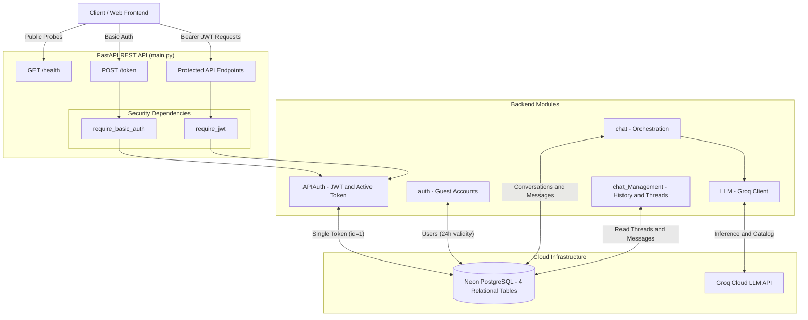
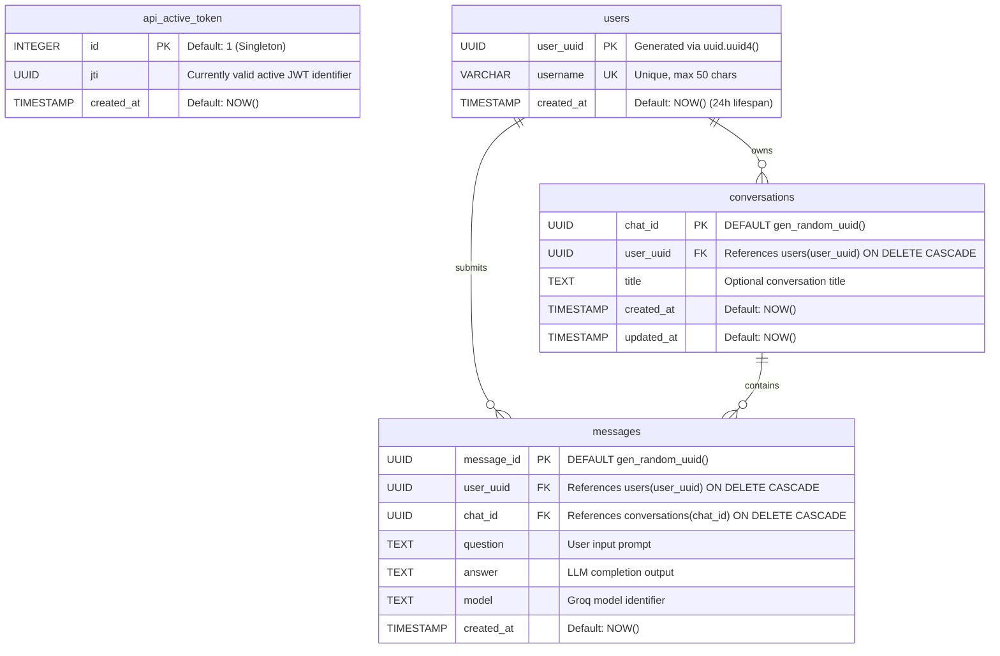
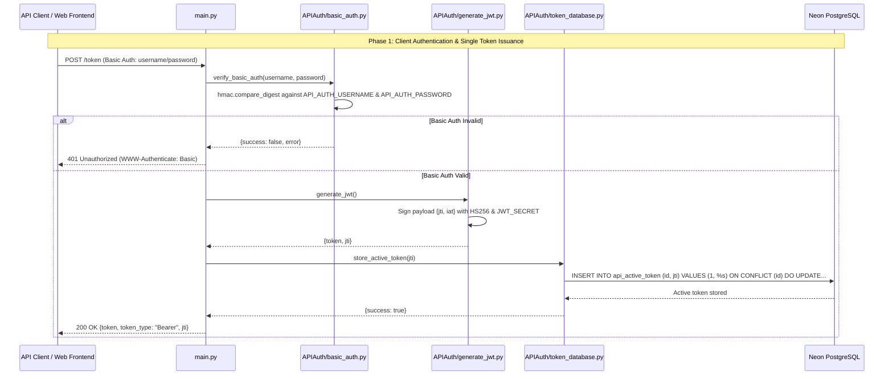
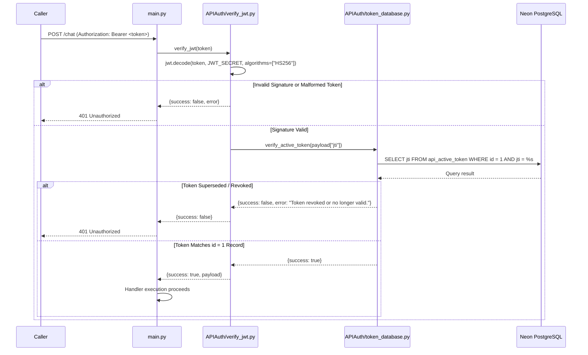
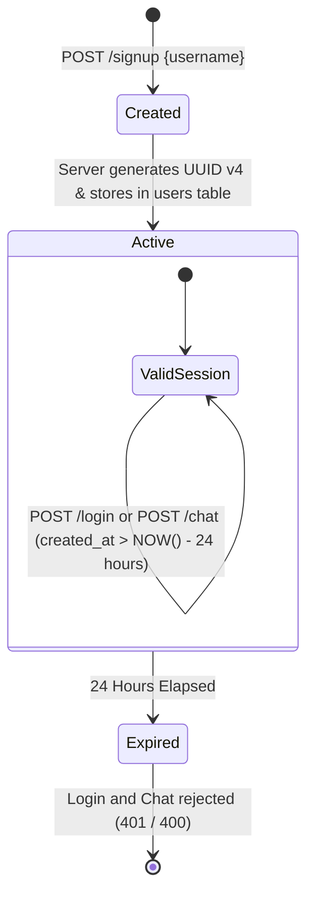
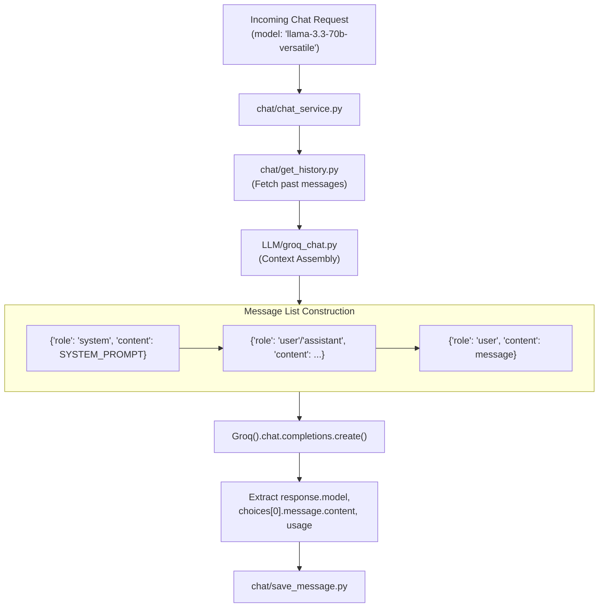

# Monarch AI Bot — Server Technical Documentation

## 1. Document Metadata and Version

| Parameter | Specification |
|---|---|
| **Document Title** | Monarch AI Bot - Server Technical Documentation |
| **Project** | Monarch AI Bot |
| **Project Version** | `v1.0.0` |
| **Documentation Version** | `v1.0.0` |
| **Document Type** | Server Backend Architecture & Implementation Reference |
| **Last Updated** | 2026-11-11 |
| **Verification Status** | Verified against source code repository |

---

## 2. Server Overview

The **Monarch AI Bot** backend is a production-grade, containerized REST API application built with **FastAPI**, **Python 3.14**, **psycopg 3**, and the **Groq Python SDK**, packaged for containerized deployment on **Render** with relational persistence in serverless **Neon PostgreSQL**.

The server enforces an enterprise-grade dual-tier security model:
1. **API Client Tier**: HTTP Basic Authentication is used to issue signed HS256 JSON Web Tokens (JWT). The backend persists the active token identifier (`jti`) in a database singleton table (`api_active_token`), enforcing a **single active token architecture** where new token generation immediately invalidates previously issued tokens globally.
2. **End-User Guest Tier**: Conversational access is gated behind guest user accounts registered with a unique username and a server-generated UUID v4. Guest accounts enforce a strict **24-hour expiration window**, validated dynamically at query time in PostgreSQL (`created_at > NOW() - INTERVAL '24 hours'`).

Conversations and message exchanges are stored relationally, and Groq LLM inference is managed with multi-turn conversational context assembly and custom system persona injection.

---

## 3. Backend Technology Stack

The backend components and dependencies defined in `pyproject.toml` and runtime configuration:

| Technology | Version | Purpose |
|---|---|---|
| **Python** | `>=3.14` | Core runtime execution language |
| **FastAPI** | `>=0.162.0` | Asynchronous high-performance REST framework, dependency injection, and OpenAPI documentation |
| **Uvicorn** | `>=0.54.0` | ASGI web server hosting the FastAPI application |
| **Groq SDK** | `>=1.7.0` | Official client library for high-throughput Groq LLM inference and dynamic model discovery |
| **PostgreSQL (Neon)** | Cloud Serverless | Cloud-hosted relational database for accounts, tokens, conversations, and message logs |
| **psycopg[binary]** | `>=3.3.8` | High-performance PostgreSQL 3 adapter using parameterized SQL execution |
| **PyJWT** | `>=2.15.1` | Cryptographic JWT encoding, decoding, signature verification, and claims validation |
| **Pydantic** | Bundled / FastAPI | Request payload validation, schema definition, and serialization |
| **python-dotenv** | `>=0.9.9` | Environment variable management from local `.env` files |
| **uv** | Astral | Blazing-fast Python package and project manager |
| **Docker** | Multi-stage | Lightweight deployment container based on `python:3.14-slim` |
| **Render** | Cloud Platform | Web service container hosting with TLS termination and automatic deployments |

---

## 4. Server Directory Structure

The backend codebase is organized modularly by domain responsibility:

```text
server/
├── APIAuth/                        # Tier 1: Client Authentication & JWT lifecycle
│   ├── basic_auth.py               # HTTP Basic Auth verification using constant-time comparison
│   ├── generate_jwt.py             # Signed HS256 JWT generator with unique UUID jti
│   ├── token_database.py           # Single active token upsert and verification in PostgreSQL
│   └── verify_jwt.py               # JWT cryptographic decode and active database verification
│
├── auth/                           # Tier 2: Guest User Identity Management
│   ├── database.py                 # Neon PostgreSQL connection factory (get_db_connection)
│   ├── login.py                    # Guest login handler verifying username, UUID, and 24h validity
│   └── signup.py                   # Guest registration generating UUID v4 and storing username
│
├── chat/                           # Conversational Core Engine
│   ├── chat_service.py             # Master orchestrator: validates user, history, LLM, and persistence
│   ├── create_chat.py              # Creates new conversation records in conversations table
│   ├── get_history.py              # Selects chronological messages for a conversation
│   └── save_message.py             # Persists question-answer pairs and updates conversation timestamps
│
├── chat_Management/                # Conversation Thread Query Services
│   ├── chat_history.py             # Validates UUID formats and retrieves message logs
│   └── get_all_chats.py            # Retrieves all user threads sorted by updated_at descending
│
├── LLM/                            # LLM Inference & System Persona
│   ├── groq_chat.py                # Assembles prompt messages array and executes Groq completions
│   ├── groq_connection.py          # Queries Groq API models catalog and formats metadata
│   └── prompt.py                   # Master system prompt defining Monarch AI persona & efficiency rules
│
├── .dockerignore                   # Excludes venv, pycache, and env files from container builds
├── .env                            # Backend environment configuration (keys, database URI, credentials)
├── .gitignore                      # Git exclusion rules
├── .python-version                 # Pinned Python version (3.14)
├── Dockerfile                      # Production container image definition using uv
├── main.py                         # FastAPI application entry point, CORS, dependencies, and API routes
├── pyproject.toml                  # Python package specifications and dependencies
└── uv.lock                         # Pinned Python dependency lockfile
```

---

## 5. Backend Architecture



---

## 6. Application Entry Point and Initialization

The application bootstraps in `server/main.py`:

### 1. CORS Configuration
CORS middleware is registered to allow incoming HTTP requests across all origins, methods, and headers:
```python
app = FastAPI()

app.add_middleware(
    CORSMiddleware,
    allow_origins=["*"],
    allow_credentials=False,
    allow_methods=["*"],
    allow_headers=["*"],
)
```

### 2. Dependency Injection Schemes
Two FastAPI security dependencies guard the endpoints:
- **`require_basic_auth`**: Extracts HTTP Basic credentials (`credentials.username`, `credentials.password`) and delegates to `APIAuth.basic_auth.verify_basic_auth()`. Raises `401 Unauthorized` with `WWW-Authenticate: Basic` header on failure.
- **`require_jwt`**: Extracts Bearer token from `Authorization: Bearer <token>` and delegates to `APIAuth.verify_jwt.verify_jwt()`. Raises `401 Unauthorized` with `WWW-Authenticate: Bearer` header if cryptographic verification fails or if the token is revoked in the database.

---

## 7. API Endpoints and Their Responsibilities

| Method | Endpoint | Handler | Auth Requirement | Summary |
|---|---|---|---|---|
| `GET` | `/health` | `health_check()` | None (Public) | Health and uptime verification probe |
| `POST` | `/token` | `create_access_token()` | HTTP Basic Auth | Issues active HS256 JWT and updates database record |
| `GET` | `/models` | `available_models()` | Bearer JWT | Returns active Groq LLM model catalog |
| `POST` | `/signup` | `user_signup()` | Bearer JWT | Registers a new guest user with UUID v4 |
| `POST` | `/login` | `user_login()` | Bearer JWT | Authenticates guest user within 24h validity window |
| `POST` | `/chat` | `user_chat()` | Bearer JWT | Processes user prompt, manages history, calls Groq, saves reply |
| `POST` | `/chat/history`| `user_chat_history()` | Bearer JWT | Returns chronological message history for a conversation |
| `POST` | `/chats` | `user_all_chats()` | Bearer JWT | Returns all conversations belonging to a user |

---

## 8. Request and Response Structures

### 1. `GET /health`
- **Request**: No parameters.
- **Response (200 OK)**:
  ```json
  {
    "success": true,
    "status": "healthy",
    "message": "Monarch AI Bot server is running."
  }
  ```

### 2. `POST /token`
- **Request Header**: `Authorization: Basic <base64(username:password)>`
- **Response (200 OK)**:
  ```json
  {
    "success": true,
    "message": "JWT generated successfully.",
    "token": "eyJhbGciOiJIUzI1NiIsInR5cCI6IkpXVCJ9...",
    "token_type": "Bearer",
    "jti": "18f92931-6b83-4a12-88ec-212bb4df59d8"
  }
  ```

### 3. `GET /models`
- **Request Header**: `Authorization: Bearer <token>`
- **Response (200 OK)**:
  ```json
  {
    "success": true,
    "total_models": 12,
    "models": [
      {
        "id": "llama-3.3-70b-versatile",
        "owned_by": "Meta",
        "created": "06 December 2024",
        "active": true,
        "context_window": 131072,
        "max_completion_tokens": 32768
      }
    ]
  }
  ```

### 4. `POST /signup`
- **Request Body**:
  ```json
  {
    "username": "monarch_researcher"
  }
  ```
- **Response (200 OK)**:
  ```json
  {
    "success": true,
    "message": "Signup successful.",
    "user": {
      "user_uuid": "13a6aaf9-a69a-4b4c-915b-cd80093552dd",
      "username": "monarch_researcher",
      "created_at": "2026-11-11T10:00:00.000000"
    }
  }
  ```

### 5. `POST /login`
- **Request Body**:
  ```json
  {
    "username": "monarch_researcher",
    "user_uuid": "13a6aaf9-a69a-4b4c-915b-cd80093552dd"
  }
  ```
- **Response (200 OK)**: Identical user payload as `/signup`.
- **Error (401 Unauthorized)**:
  ```json
  {
    "detail": "Account expired. The 24-hour signup period has ended."
  }
  ```

### 6. `POST /chat`
- **Request Body**:
  ```json
  {
    "user_uuid": "13a6aaf9-a69a-4b4c-915b-cd80093552dd",
    "model": "llama-3.3-70b-versatile",
    "message": "Explain vector embeddings concisely.",
    "chat_id": "f2157002-8565-4a9d-8528-016e785ad36f"
  }
  ```
- **Response (200 OK)**:
  ```json
  {
    "success": true,
    "user_uuid": "13a6aaf9-a69a-4b4c-915b-cd80093552dd",
    "chat_id": "f2157002-8565-4a9d-8528-016e785ad36f",
    "question": "Explain vector embeddings concisely.",
    "answer": "Vector embeddings are numerical representations of data points...",
    "model": "llama-3.3-70b-versatile",
    "usage": {
      "prompt_tokens": 142,
      "completion_tokens": 38,
      "total_tokens": 180
    }
  }
  ```

### 7. `POST /chat/history`
- **Request Body**:
  ```json
  {
    "user_uuid": "13a6aaf9-a69a-4b4c-915b-cd80093552dd",
    "chat_id": "f2157002-8565-4a9d-8528-016e785ad36f"
  }
  ```
- **Response (200 OK)**:
  ```json
  {
    "success": true,
    "chat_id": "f2157002-8565-4a9d-8528-016e785ad36f",
    "user_uuid": "13a6aaf9-a69a-4b4c-915b-cd80093552dd",
    "total_messages": 1,
    "history": [
      {
        "question": "Explain vector embeddings concisely.",
        "answer": "Vector embeddings are numerical representations...",
        "model": "llama-3.3-70b-versatile",
        "created_at": "2026-11-11T10:05:00.000000"
      }
    ]
  }
  ```

### 8. `POST /chats`
- **Request Body**:
  ```json
  {
    "user_uuid": "13a6aaf9-a69a-4b4c-915b-cd80093552dd"
  }
  ```
- **Response (200 OK)**:
  ```json
  {
    "success": true,
    "user_uuid": "13a6aaf9-a69a-4b4c-915b-cd80093552dd",
    "total_conversations": 1,
    "conversations": [
      {
        "chat_id": "f2157002-8565-4a9d-8528-016e785ad36f",
        "title": null,
        "created_at": "2026-11-11T10:05:00.000000",
        "updated_at": "2026-11-11T10:05:30.000000"
      }
    ]
  }
  ```

---

## 9. Database Architecture and Schema

Relational data is stored in **Neon PostgreSQL**. Direct parameterized SQL is executed using `psycopg 3` without an Object-Relational Mapper (ORM).

### Entity Relationship Diagram



### Table Definitions & Constraints

1. **`api_active_token`**:
   - `id`: Primary key with a default value of `1`.
   - `jti`: UUID of the currently valid JWT. An `ON CONFLICT (id) DO UPDATE` query overwrites this row on each `/token` invocation, ensuring only one active token can exist.
   - `created_at`: Timestamp recording token registration.
2. **`users`**:
   - `user_uuid`: Primary key storing server-generated UUID v4.
   - `username`: Case-sensitive display name enforced by unique constraint `users_username_key` (length $\le 50$).
   - `created_at`: Timestamp establishing the 24-hour expiration clock.
3. **`conversations`**:
   - `chat_id`: Primary key UUID.
   - `user_uuid`: Foreign key referencing `users.user_uuid` with `ON DELETE CASCADE`.
   - `title`: Nullable text string.
   - `created_at` / `updated_at`: Timestamps. `updated_at` is refreshed whenever a new message is appended.
4. **`messages`**:
   - `message_id`: Primary key UUID.
   - `user_uuid`: Foreign key referencing `users.user_uuid`.
   - `chat_id`: Foreign key referencing `conversations.chat_id`.
   - `question` / `answer`: Non-empty text fields storing user prompt and AI response.
   - `model`: String identifying the Groq model used for generation.
   - `created_at`: Creation timestamp used for ascending chronological ordering.

---

## 10. Database Interactions

Database connections are created using context-managed psycopg connections in `auth/database.py`:

```python
def get_db_connection():
    database_url = os.getenv("DATABASE_URL")
    if not database_url:
        raise ValueError("DATABASE_URL is not configured")
    try:
        connection = psycopg.connect(database_url)
        return connection
    except psycopg.Error as e:
        raise ConnectionError(f"Failed to connect to Neon PostgreSQL: {e}") from e
```

- **Parameterized Queries**: All SQL statements across `APIAuth/`, `auth/`, `chat/`, and `chat_Management/` pass parameters as tuples (`%s`), strictly preventing SQL injection.
- **Connection Management**: Python's `with get_db_connection() as conn:` context managers ensure that connections and cursor transactions are automatically committed upon block exit and closed upon termination.

---

## 11. Authentication and Authorization Implementation

### Dual-Layer Security Model



---

## 12. JWT Handling and Validation

### Cryptographic and Database Validation Sequence

When a request arrives at a protected endpoint (e.g., `POST /chat`), the `require_jwt` dependency triggers:



- **Secret Validation**: Enforces that `JWT_SECRET` contains at least 32 bytes (`len(jwt_secret.encode('utf-8')) >= 32`).
- **Required Claims**: Decoding strictly requires both `jti` and `iat`.

---

## 13. Guest Account Lifecycle



1. **Registration**: `auth.signup.signup(username)` generates `uuid.uuid4()`, trims the username, and executes an `INSERT INTO users (user_uuid, username) RETURNING ...`.
2. **Validation**: Both `login.py` and `chat_service.py` evaluate the 24-hour rule via PostgreSQL:
   ```sql
   SELECT (created_at > NOW() - INTERVAL '24 hours') AS is_valid
   FROM users
   WHERE user_uuid = %s
   ```
3. **Expiration**: Once 24 hours elapse from `created_at`, subsequent `/login` calls return `401 Unauthorized ("Account expired...")`, and `/chat` calls return `400 Bad Request`.

---

## 14. Conversation and Message Management

Conversation orchestration is encapsulated in `chat/chat_service.py`:
- **Eligibility**: Confirms `user_uuid` is valid and active within its 24-hour window.
- **Ownership Verification**: If an existing `chat_id` is supplied, verifies that `conversations.user_uuid == user_uuid`.
- **Dynamic Thread Creation**: If `chat_id` is omitted (`null`), automatically calls `create_chat(user_uuid)` to initialize a new conversation row.
- **Message Persistence**: Inserts question, answer, and model into `messages`, and updates `conversations.updated_at = NOW()`.
- **Thread Retrieval**: `chat_Management/get_all_chats.py` retrieves threads ordered by `updated_at DESC`.

---

## 15. LLM Provider Integration

Inference is powered by the official **Groq Python SDK** (`groq.Groq`):
- **Model Discovery (`LLM/groq_connection.py`)**:
  Calls `client.models.list()`, filters active models, and transforms Unix creation timestamps into human-readable UTC strings (`format_created_date`).
- **Completions Engine (`LLM/groq_chat.py`)**:
  Injects `SYSTEM_PROMPT` from `LLM/prompt.py`, appends historical message exchanges, adds the current prompt, and calls `client.chat.completions.create(model=model, messages=messages)`.
- **Token Metrics**: Extracts and returns token metrics from `response.usage` (`prompt_tokens`, `completion_tokens`, `total_tokens`).

---

## 16. Model Selection and Invocation



---

## 17. Conversation History Handling

The LLM prompt payload is constructed systematically in `LLM/groq_chat.py`:

```python
messages = [{"role": "system", "content": SYSTEM_PROMPT}]

for item in history:
    messages.extend([
        {"role": "user", "content": item["question"]},
        {"role": "assistant", "content": item["answer"]}
    ])

messages.append({"role": "user", "content": message})
```

This guarantees that multi-turn context is preserved across conversational exchanges while remaining bounded by the historical messages persisted for that specific `chat_id`.

---

## 18. Error Handling and Validation

The backend translates internal errors and third-party exceptions into standardized HTTP error responses:

| Error Category | Trigger / Exception | Handled Location | HTTP Status | Response Payload |
|---|---|---|---|---|
| **Pydantic Validation** | Malformed JSON or invalid types | FastAPI Request Parser | `422 Unprocessable` | Validation error detail array |
| **Basic Auth Failure** | Invalid username or password | `APIAuth/basic_auth.py` | `401 Unauthorized` | `{"detail": "Invalid Basic Auth credentials."}` |
| **JWT Verification** | Invalid signature or algorithm | `APIAuth/verify_jwt.py` | `401 Unauthorized` | `{"detail": "Invalid JWT signature."}` |
| **Token Revocation** | `jti` mismatch in `api_active_token` | `APIAuth/token_database.py`| `401 Unauthorized` | `{"detail": "Token revoked or no longer valid."}` |
| **Username Conflict** | `UniqueViolation` on `users_username_key` | `auth/signup.py` | `400 Bad Request` | `{"detail": "Username already exists..."}` |
| **Expired Guest** | `created_at <= NOW() - 24 hours` | `auth/login.py` | `401 Unauthorized` | `{"detail": "Account expired. The 24-hour..."}` |
| **Thread Ownership** | Conversation belongs to another user | `chat/chat_service.py` | `400 Bad Request` | `{"detail": "Conversation not found or..."}` |
| **Groq Auth** | `groq.AuthenticationError` | `LLM/groq_chat.py` | `400 Bad Request` | `{"detail": "Invalid Groq API key."}` |
| **Groq Rate Limit** | `groq.RateLimitError` | `LLM/groq_chat.py` | `400 Bad Request` | `{"detail": "Groq API rate limit exceeded."}` |
| **Groq Connection** | `groq.APIConnectionError` | `LLM/groq_chat.py` | `400 Bad Request` | `{"detail": "Unable to connect to Groq API."}` |
| **Database Failure** | `psycopg.Error` / Connection | Database modules | `500 Internal Error` | `{"detail": "Database connection failed."}` |

---

## 19. Environment Configuration

All server configurations are managed via environment variables:

| Variable | Required | Type | Purpose |
|---|---|---|---|
| `DATABASE_URL` | **Yes** | String (URI) | Neon PostgreSQL connection URI with SSL mode enabled |
| `GROQ_API_KEY` | **Yes** | String | Secret API key for Groq LLM completions |
| `API_AUTH_USERNAME` | **Yes** | String | Administrative username for HTTP Basic Auth token generation |
| `API_AUTH_PASSWORD` | **Yes** | String | Administrative password for HTTP Basic Auth token generation |
| `JWT_SECRET` | **Yes** | String (>=32 bytes) | Cryptographic key for signing and verifying HS256 JWTs |
| `JWT_ALGORITHM` | No | String | Signing algorithm (defaults to `HS256`) |

---

## 20. Security Considerations

1. **Timing Attack Mitigation**: Credentials supplied to HTTP Basic Auth are verified using `hmac.compare_digest` in `APIAuth/basic_auth.py`, eliminating timing side-channel attacks.
2. **Single Active Token Enforcement**: Generating a new JWT at `POST /token` replaces the `jti` in `api_active_token (id=1)`. This immediately invalidates all prior tokens across all clients.
3. **SQL Injection Immunity**: Database queries use strict parameterized input tuples (`cursor.execute(sql, (param,))`). No queries use string interpolation or concatenation.
4. **Credential Isolation**: Secrets, passwords, connection strings, and keys are stored exclusively in environment variables and are excluded from git and Docker contexts via `.gitignore` and `.dockerignore`.
5. **Cascading Relational Cleanup**: Foreign keys in `conversations` and `messages` specify `ON DELETE CASCADE`. If a user record is removed, all associated threads and message logs are purged automatically.

---

## 21. Deployment and Runtime Behavior

### Containerized Execution (`Dockerfile`)
```dockerfile
FROM python:3.14-slim
WORKDIR /app
COPY --from=ghcr.io/astral-sh/uv:latest /uv /uvx /bin/
ENV PYTHONUNBUFFERED=1 UV_COMPILE_BYTECODE=1 UV_LINK_MODE=copy
COPY pyproject.toml uv.lock ./
RUN uv sync --frozen --no-install-project
COPY . .
ENV PATH="/app/.venv/bin:$PATH"
EXPOSE 8000
CMD ["uvicorn", "main:app", "--host", "0.0.0.0", "--port", "8000"]
```

### Local Execution
```bash
cd server
uv run uvicorn main:app --reload --host 0.0.0.0 --port 8000
```
Interactive OpenAPI documentation is generated automatically:
- Swagger UI: `http://localhost:8000/docs`
- ReDoc: `http://localhost:8000/redoc`

### Render Cloud Platform
The backend deploys as a Docker Web Service on Render:
- **Port**: Bound to port `8000`.
- **Health Check Probe**: Monitored via `/health`.
- **TLS Termination**: Provided automatically by Render edge proxies.

